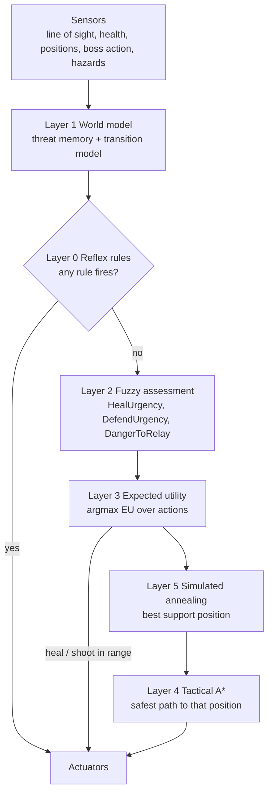

# Relay — Autonomous Support Companion: Agent Design

**Module:** SE3062 Intelligent Systems — Autonomous Agents in 3D Environments
**Agent owner:** Student 1 (Relay). The Rift Warden boss is an additional, separately documented agent.
**Status:** design baseline (step 1 of the build plan, section 9). Sections marked *Current* describe the code as it is today; everything else is the target design.

Relay is a small hovering support robot that accompanies the player (Arc) through the Skybreak dungeon and the Rift Warden fight. It keeps the player alive, protects them, and stays out of their way, without being controlled by the player.

---

## 1. Why Relay needs more than a basic search

The brief requires each agent to use "a decision-making architecture that goes beyond a basic uninformed search". Relay meets this with a **hybrid (subsumption) architecture** (Lecture 03, slide 62): five layers, each a named course technique, stacked so that fast reflexes override slower reasoning.

| Layer | Purpose | Technique | Lecture |
|---|---|---|---|
| 0 Reflex | Survive immediate danger | Prioritised condition-action rules | L03 Simple Reflex, subsumption |
| 1 World model | Remember what it cannot currently see | Internal state + transition model | L03 Model-Based, L02 partial observability |
| 2 Assessment | Judge how urgent each need is | Fuzzy Inference System (Mamdani, COG) | L09 Parts 3–4 |
| 3 Decision | Choose the best action | Expected-utility selection | L03 Utility-Based |
| 4 Planning | Reach a position safely | Tactical A* with an admissible heuristic | L05 Informed Search |
| 5 Positioning | Find the best place to stand | Simulated annealing (local search) | L05 Local Search |

*Current* (`Assets/Scripts/AI/Relay/RelayBrain.cs`): a single utility selector with hand-tuned linear scores for Follow / Heal / Defend / Retreat, 3 s of threat memory, and Unity's NavMesh for movement. This is the baseline that the evaluation in section 8 compares against.

---

## 2. Task environment — PEAS (Lecture 02)

| | Relay |
|---|---|
| **Performance measure** | Player survival time and health kept above 30%; heals applied while the player is genuinely in need; damage dealt to visible threats; damage Relay itself takes (lower is better); time spent blocking the player's line of fire (lower is better); never stuck or idle when needed. |
| **Environment** | The Skybreak dungeon (entrance court, winding passage, security wing, final chamber) and the Rift Warden arena: walls, doors, crates, pillars, a baked NavMesh, the player Arc, the Rift Warden and its damageable parts, boss hazards (slam landing zone, cannon line, blade sweep). |
| **Actuators** | Hover movement (`IAgentMotor.MoveTo` / `Stop`); heal beam (`DamageSink.RestoreHealth` on the player); defensive shot (`DamageSink.ReceiveDamage` on a hostile); facing/turning of its visual; beam and audio cues (`CombatSignals`, `CombatAudio`). |
| **Sensors** | Line-of-sight checks to every active `DamageSink` (`DamageSink.Visible`); distances; the player's health and position; Relay's own health; the boss's current `RiftAction` and which parts are vulnerable; NavMesh queries (reachability, `NavMesh.Raycast`); hazard zones announced by the encounter. |

### Percepts and actions

- **Percept** (sampled every `senseInterval` = 0.2 s): `{ playerPos, playerVel, playerHealth01, relayPos, relayHealth01, visibleThreats[{id, pos, vel, danger}], bossAction, hazards[{centre, radius, timeToImpact}], healReady, attackReady }`.
- **Actions:** `Follow`, `Heal`, `Defend`, `Retreat`, `Reposition`, `Evade` (new; reflex layer only), `Disabled`.

---

## 3. Environment dimensions (Lecture 02) and their design consequences

| Dimension | Relay's world | Consequence for the design |
|---|---|---|
| Fully vs partially observable | **Partially observable.** Walls hide enemies, and the boss teleports out of sight. | A simple reflex agent is not enough, so Relay needs a world model with memory (layer 1). |
| Single vs multi-agent | **Multi-agent**: cooperative with the player, competitive with the boss. | Positions are judged relative to both (stay near Arc, stay hidden from the boss); the player's line of fire is a constraint. |
| Deterministic vs stochastic | **Stochastic** from Relay's view: the player's input is unknown, and the boss picks attacks it cannot see. | Decisions use degrees of belief (fuzzy sets), and actions are scored by *expected* utility. |
| Episodic vs sequential | **Sequential.** Healing now puts heal on cooldown; position now decides exposure later. | Cooldowns and memory are part of the state; positions are planned (A*), not reacted to. |
| Static vs dynamic | **Dynamic.** The world moves while Relay thinks. | Real-time budget: a decision cycle every 0.2 s, an A* node limit, a fixed annealing iteration count, and replanning when the goal moves. |
| Discrete vs continuous | **Continuous** positions and health. | Continuous inputs are fuzzified (layer 2), and space is discretised into a waypoint graph for A* (layer 4); annealing searches continuous positions directly (layer 5). |
| Known vs unknown | **Known** physics and rules; the map layout is known through the NavMesh. | No learning is needed for correctness; an optional learning critic is a stretch goal (section 9). |

---

## 4. Architecture



### 4.1 Agent program (one decision cycle)

```
function RELAY-AGENT(percept) returns action
    persistent: model (layer 1), plan (current A* path), lastAction
    model ← UPDATE-MODEL(model, percept)                       // layer 1
    rule ← FIRST-MATCHING-REFLEX(model)                         // layer 0, by priority
    if rule ≠ none then return rule.action
    urgency ← FUZZY-ASSESS(model)                               // layer 2
    action ← argmax over a in Actions of EU(a | model, urgency) // layer 3
    if action needs a position then
        goal ← ANNEAL-POSITION(action, model)                   // layer 5
        if plan is empty or goal moved > 1.5 m or plan older than 1 s or threats changed then
            plan ← TACTICAL-A*(relayPos, goal, model)           // layer 4
    return EXECUTE(action, plan)

(Reposition's expected utility needs layer 5's answer, so the support-spot search runs before layer 3 each cycle; it is cached for 0.6 s.)
```

### 4.2 Layer 0 — Reflex safety layer (Lecture 03)

These are condition-action rules checked in priority order (the "drone obstacle" activity's question of rule priority). The first one that matches wins and skips all deliberation that cycle: subsumption.

| Priority | Condition | Action | Status |
|---|---|---|---|
| 1 | Relay health = 0 | `Disabled`: stop and clear signals | Implemented (`RelayReflexes`) |
| 2 | Player is down | Stop and wait | Implemented (`RelayReflexes`) |
| 3 | Relay is inside a boss hazard zone with time-to-impact < 1.2 s | `Evade` to the nearest NavMesh point outside the zone | **Not implemented**: needs the boss to publish its slam/landing zones (a read-only hazard registry); left as future work so `RiftWardenBrain` is not changed |
| 4 | Relay is within the player's line of fire | Side-step | **Handled deliberatively instead**: layer 5 detects the fire lane and layer 3 selects `Reposition` (EU 0.5) |

Why reflexes: they are cheap and immediate, which matters in a dynamic world. Lecture 03's self-driving example uses the same split: a utility engine plans the route, and a reflex layer works the brakes.

### 4.3 Layer 1 — World model (Lecture 03, model-based)

| State variable | Updated from | Transition model (when unseen) |
|---|---|---|
| Threat track `{lastPos, velocity, lastSeen}` per hostile | Line-of-sight sightings | Constant velocity: `predicted = lastPos + velocity·Δt`, capped at 4 m |
| Threat confidence `c` | Set to 1 on sighting | Decays `c = e^(−Δt/τ)`, τ = 1.5 s; the track is forgotten when c < 0.1 |
| Player health trend | Health samples | Rate of health loss over the last 2 s (smoothed) |
| Hazards `{centre, radius, timeToImpact}` | Encounter warnings | Removed after impact |
| Cooldowns, own health | Own actions / damage | Count down in real time |

*Current:* only one remembered position with a fixed 3 s memory. The new model keeps per-threat tracks, predicts movement, and gives a confidence that later layers use as a probability.

### 4.4 Layer 2 — Fuzzy assessment (Lecture 09, Fuzzy Inference System)

A Mamdani FIS following the lecture pipeline: **fuzzify, apply rules (AND = min, OR = max), aggregate (max), defuzzify by centre of gravity (COG)**.

**Inputs and membership functions** (trapezoid `[a,b,c,d]`, triangle `[a,b,c]`), as implemented in `RelayFuzzyModel.cs`:

| Linguistic variable | Universe | Terms |
|---|---|---|
| `PlayerHealth` | 0–1 | Critical `[0,0,.15,.3]`, Low `[.2,.45,.7]`, Healthy `[.55,.8,1,1]` |
| `ThreatDistance` (threat to player) | 0–20 m | Near `[0,0,4,8]`, Medium `[5,10,15]`, Far `[12,16,20,20]`; 20 when no threat is visible |
| `HealthTrend` (player health lost per second, over 2 s) | 0–.2 | Stable `[0,0,.01,.03]`, Dropping `[.02,.05,.08]`, Plummeting `[.06,.1,.2,.2]` |
| `RelayHealth` | 0–1 | Weak `[0,0,.2,.4]`, Okay `[.3,.6,1,1]` |

**Outputs** (each 0–1, terms Low `[0,0,.2,.4]`, Medium `[.3,.5,.7]`, High `[.6,.8,1,1]`): `HealUrgency`, `DefendUrgency`, `SelfPreservation`. With no rule firing an output defaults to 0.

**Rule base (implemented):**

| Rule | IF | THEN |
|---|---|---|
| H1 | PlayerHealth is Critical | HealUrgency is High |
| H2 | PlayerHealth is Low AND (HealthTrend is Dropping OR Plummeting) | HealUrgency is High |
| H3 | PlayerHealth is Low | HealUrgency is Medium |
| H4 | PlayerHealth is Healthy | HealUrgency is Low |
| D1 | ThreatDistance is Near AND PlayerHealth is Healthy | DefendUrgency is High |
| D2 | ThreatDistance is Near AND PlayerHealth is NOT Healthy | DefendUrgency is Medium |
| D3 | ThreatDistance is Medium AND PlayerHealth is Healthy | DefendUrgency is Medium |
| D4 | ThreatDistance is Medium AND PlayerHealth is NOT Healthy | DefendUrgency is Low |
| D5 | ThreatDistance is Far | DefendUrgency is Low |
| D6 | HealthTrend is Plummeting AND ThreatDistance is NOT Far | DefendUrgency is High |
| S1 | RelayHealth is Weak AND ThreatDistance is Near | SelfPreservation is High |
| S2 | RelayHealth is Weak AND ThreatDistance is Medium | SelfPreservation is Medium |
| S3 | RelayHealth is Weak AND ThreatDistance is Far | SelfPreservation is Low |
| S4 | RelayHealth is Okay | SelfPreservation is Low |

**Change from the first draft.** Tracing the draft rules by hand for "player at 50%, boss 7.5 m away" gave DefendUrgency ≈ 0.53 and HealUrgency ≈ 0.35, so a support robot would shoot instead of heal. The final rules make defending strong only while the player is Healthy (D1–D4), and every Low-health state gets at least Medium heal urgency (H3). The same case now gives HealUrgency 0.50 and DefendUrgency 0.24 (worked below); the lab scenario "heal at 50%" measured 0.50 and 0.18, its boss being slightly further away (`Docs/IS/Testing/Relay/step3_fuzzy_utility.txt`).

**Worked example (player 50% health, no recent damage, boss 7.5 m from the player, Relay healthy):**
- Fuzzification: PlayerHealth: Low = (.7 − .5)/.25 = 0.8, Healthy = 0, Critical = 0. ThreatDistance: Near = (8 − 7.5)/4 = 0.125, Medium = (7.5 − 5)/5 = 0.5. HealthTrend: Stable = 1.
- Firing: H3 = 0.8 (Medium); H2 = min(0.8, 0) = 0; D2 = min(0.125, 1 − 0) = 0.125 (Medium); D4 = min(0.5, 1) = 0.5 (Low).
- Aggregation: HealUrgency {Medium 0.8}; DefendUrgency {Medium 0.125, Low 0.5}.
- COG: HealUrgency = 0.50 (the clipped Medium triangle is symmetric about 0.5); DefendUrgency = 0.24 (most of the mass is in the Low set, capped at 0.5).

Why fuzzy: "low health" and "near" are vague concepts with no correct crisp threshold. The step-2 code's single `healThreshold = 0.25` is exactly the crisp-logic failure the lecture describes; fuzzy rules degrade smoothly instead.

### 4.5 Layer 3 — Expected-utility selection (Lecture 03)

`EU(a) = P(success | a, state) × U(a)`. Relay picks `argmax EU`, with a small hysteresis bonus (+0.05) for keeping the current action so it does not flicker between two choices.

| Action | U(a) | P(success \| a, state) |
|---|---|---|
| Heal | `HealUrgency` | 0 if the player is down or the heal is on cooldown; 1 if Relay is in heal range with line of sight; 0.7 if it must fly into range first |
| Defend | `DefendUrgency` (only a currently visible, vulnerable target, so threat confidence = 1) | 0 without a target or on cooldown; 1 if the target is within attack range; 0.6 if Relay must reposition first |
| Retreat | `SelfPreservation` | 1 if a threat was seen within the memory window, else 0 (step 5 adds "a reachable safe spot exists") |
| Follow | `0.2 + 0.4 × clamp(distanceToPlayer / 9)` | 1 (always possible; the fallback action) |
| Reposition | `0.3 × (exposure here − exposure at the new spot) + 0.5 × (in fire lane here − in fire lane there)` | 1 when layer 5 found a spot better overall by > 0.1, else 0 |

An action with EU 0 is never chosen over Follow. Ties go to Retreat, then Heal, Defend, Reposition, Follow. Reposition values the *improvement* a move brings, not how bad the current spot is: in open ground every spot is equally exposed, so moving gains nothing and Relay keeps following. The old linear-score fields in `RelayTuning` (`healThreshold`, `followBase`, `retreatUtility`, …) are no longer read by Relay.

Outcomes are uncertain because the boss and player act unpredictably, and threats come from a memory with confidence below 1. That is why utilities are weighted by probability instead of used directly: this is the lecture's expected-utility formulation.

### 4.6 Layer 4 — Tactical A* (Lecture 05, Informed Search)

Relay finds routes with **its own A*** instead of handing the destination straight to Unity's NavMesh, so that "safe" can be part of the path cost.

- **Graph:** a 1 m grid of nodes sampled on the NavMesh (`NavMesh.SamplePosition`) within 20 m of Relay. There are edges to the 8 neighbours where `NavMesh.Raycast` is clear, built lazily and cached per area.
- **Step cost:** `c(n, n') = |n − n'| + λ · exposure(n')`, where `exposure(n') ∈ [0,1]` is the summed confidence of remembered threats with line of sight to `n'` (capped at 1), and λ = 3 by default.
- **Heuristic:** `h(n) = |n − goal|`, the straight-line distance, the same relaxed-problem idea as the lecture's `h_SLD`.
  - **Admissible:** every step costs at least its length (exposure ≥ 0), so the true remaining cost ≥ straight-line distance.
  - **Consistent:** `h(n) ≤ |n − n'| + h(n') ≤ c(n, n') + h(n')` by the triangle inequality. So A* with graph search returns the cheapest (safest-and-shortest) path (Lecture 05 theorem).
- **Frontier:** a binary-heap priority queue on `f = g + h`, with a closed set. The node limit is 2,500 per search; past that the search returns the best partial path (closest by `h`) and logs it.
- **Execution:** `RelayBrain.NavigateTo` follows the route: it skips reached waypoints and steers towards the farthest waypoint within 3 m that is in straight NavMesh reach, using `NavMeshMotor` only for the short hop. Within the stop distance + 3 m of the goal it approaches directly. The choice of route is Relay's own.
- **Replanning triggers:** the goal moved more than 1.5 m, the plan is older than 1 s, or the number of known threats changed (a new threat appeared or one was forgotten).
- **Fallback:** if the local grid has no route (for example a door narrower than the 1 m cells) or the search hits its 2,500-node budget, Relay says so in `PlannerStatus` and falls back to Unity's NavMesh path for that move. The overlay shows which one is in use.
- **Comparison for the defence:** the same engine (`BestFirstSearch`) runs A* (`f = g + h`), uniform-cost search (`f = g`, Lecture 04) and greedy best-first (`f = h`).

**Measured results** (`Docs/IS/Testing/Relay/step4_*`):

| Check | Result |
|---|---|
| Lecture 05 Romania, Arad → Bucharest | A* 418 km via Rimnicu Vilcea and Pitesti (optimal), expanding 5 nodes; uniform-cost 418 km, expanding 12; greedy 450 km via Fagaras (not optimal) |
| 60 random danger-weighted grids | A* cost = uniform-cost cost every time, with ≤ the nodes expanded |
| Real arena, boss in view, 11.3 m route | Tactical A* expanded 136 nodes vs uniform-cost 279 for the same optimal route; λ = 0 A* expanded only 8 |
| Real arena, best detour in a 48-goal sweep | Shortest route 11.7 m through 11 watched cells; tactical route 13.1 m through 9 |

The λ = 0 / λ = 3 difference in expanded nodes is a useful defence point: the straight-line heuristic is admissible in both cases, but it is far more *informed* when cost ≈ distance. When exposure dominates the cost, h underestimates more, so A* explores more (still far less than uniform-cost search).

### 4.7 Layer 5 — Support position by simulated annealing (Lecture 05, Local Search)

Where Relay *should* stand is an optimisation problem: only the final state matters, not the path, so this is local search, not pathfinding.

- **State:** a candidate point `x` on the NavMesh.
- **Objective (maximise):**
  `E(x) = w1·inHealRange(x) + w2·hiddenFromThreats(x) + w3·lineOfSightToPlayer(x) − w4·inPlayerFireLane(x) − w5·inHazard(x) − w6·distanceFromRelay(x)/10`
  The weights depend on the chosen action: Retreat raises `w2`; Defend swaps `hiddenFromThreats` for `lineOfSightToTarget`.
- **Neighbour:** move `x` by a random offset of up to `r = 2 m` (shrinking with temperature), snapped to the NavMesh.
- **Acceptance:** always accept improvements; accept a worse move with probability `P = e^(ΔE / T)`.
- **Schedule:** T₀ = 1.0, geometric cooling `T ← 0.85·T`, 60 iterations per decision (a fixed budget, because the world is dynamic), and a warm start from the previous best spot.
- **Why not hill climbing:** hill climbing gets stuck on local maxima. Behind a crate the score is good, but behind a pillar 3 m away it is better, and the scores dip between the two. Annealing's occasional downhill moves escape local maxima (lecture slide "Overcoming Local Minima"). Hill climbing is implemented as the comparison baseline (`HillClimbing`).

**As implemented** (`RelayPositionSearch.cs`, `SimulatedAnnealing.cs`):

| Goal (used by) | E(x) |
|---|---|
| Support (Follow, Reposition) | `1.0·band(d_player, 1.8–3.5 m) + 0.6·sees(player) + 1.0·(1 − exposure) − 1.5·inFireLane − 0.15·dist(formation) − 0.05·travel` |
| Heal | `2.0·within(d_player, 0.85·healRange) + 1.0·sees(player) + 0.8·(1 − exposure) − 1.5·inFireLane − 0.08·travel` |
| Defend | `2.0·within(d_target, 0.9·attackRange) + 1.5·sees(target) + 0.3·(1 − exposure) − 1.5·inFireLane − 0.08·travel` |
| Retreat | `1.5·(1 − exposure) + 0.15·min(distance from threats, 12) + 0.5·within(d_player, 8 m) − 0.1·travel` |

- The fire lane is the strip 1.1 m either side of the player's facing direction, from 0.5 m to 15 m in front.
- Points beyond 12 m from Relay are penalised.
- Scores are cached on a 0.25 m grid during one search.
- 60 iterations, T₀ = 1, α = 0.85; the neighbour radius shrinks from 3 m to 0.5 m as T falls. Searches refresh every 0.6 s, warm-started from the previous best, with a seeded random generator so the same situation gives the same result.

**Measured** (`Docs/IS/Testing/Relay/step5_*`):
- **Two-peak landscape, 100 seeded runs (EditMode test):** annealing reached the global peak 38 times, hill climbing 0 times. It always stops on the first peak.
- **Acceptance probability:** `P(ΔE = −1, T = 1) = e⁻¹ ≈ 0.37`, and `P(ΔE = −1, T = 0.1) = e⁻¹⁰`. The test checks both.
- **Lab, Relay 3 m in front of the player:** Reposition chosen (EU 0.50 vs Follow 0.38). Annealing accepted 9 worse moves, and the chosen spot is out of the fire lane.

---

## 5. Constraints and boundaries

- Relay only reads other agents (`RiftWardenBrain`, player health); it never changes their behaviour. Hazard information comes from a read-only registry that the encounter publishes.
- **Real-time budget per decision cycle:** A* ≤ 2,500 node expansions, annealing ≤ 60 iterations, line-of-sight raycasts cached for 0.2 s.
- Tuning values stay in `AgentTuningData` (`RelayTuning`) so they can be adjusted without code changes.
- The existing presentation scripts (`RelayPodAnimator`, audio, signals) keep working because `RelayBrain.Action` and its public scores remain available.

## 6. Code structure (planned)

| File | Contents |
|---|---|
| `Assets/Scripts/AI/Relay/RelayBrain.cs` | Orchestrates the decision cycle (4.1) and exposes `Action`, `Decision` and scores |
| `Assets/Scripts/AI/Relay/RelayPerception.cs` | Sensors + world model (layer 1) |
| `Assets/Scripts/AI/Relay/RelayReflexes.cs` | Reflex rules (layer 0) |
| `Assets/Scripts/AI/Relay/RelayUtility.cs` | Expected-utility selection (layer 3) |
| `Assets/Scripts/AI/Algorithms/Fuzzy/*.cs` | Generic FIS: membership functions, rules, Mamdani inference, COG |
| `Assets/Scripts/AI/Algorithms/Search/*.cs` | Generic A* over a graph interface, priority queue |
| `Assets/Scripts/AI/Algorithms/Local/SimulatedAnnealing.cs` | Generic annealer over a state type |
| `Assets/Scripts/AI/Relay/RelayTacticalGraph.cs` | NavMesh-sampled grid + exposure costs (layer 4) |
| `Assets/Scripts/AI/Relay/RelayPositionSearch.cs` | Objective function + annealing (layer 5) |
| `Assets/Scripts/AI/Relay/RelayDebugOverlay.cs` | Live visualisation for the demo and defence |
| `Assets/Tests/EditMode/RelayAlgorithms/*.cs` | Unit tests |

The algorithms (`Assets/Scripts/AI/Algorithms`) are pure C# in their own assembly definition (`Skybreak.AI.Algorithms`), depending only on `UnityEngine` math types. This keeps them independent of the scene and testable in EditMode.

## 7. Requirement-to-lecture map (for the technical defence)

| Question an examiner may ask | Answer and where to show it |
|---|---|
| What architecture is Relay? | Hybrid / subsumption (L03): reflex override above a model-based, utility-based deliberative core. *Show:* section 4 diagram, `RelayBrain.Decide`. |
| Why not a simple reflex agent? | The environment is partially observable (L02/L03), and Relay has to remember threats behind walls. *Show:* layer 1 tracks, overlay of predicted positions. |
| How is it beyond uninformed search? | Informed A* with an admissible, consistent heuristic (L05), plus local search (L05), fuzzy reasoning (L09) and expected utility (L03). *Show:* expanded node counts, A* vs UCS. |
| Is your heuristic admissible? | Yes: step cost ≥ step length, and h is the straight-line distance (proof in 4.6). *Show:* unit test comparing with Dijkstra. |
| Why fuzzy logic? | Health and distance thresholds are vague; crisp cut-offs make the agent flip at the boundary. *Show:* membership degrees live, and the COG worked example as a test. |
| Why simulated annealing? | Position choice is an optimisation with local maxima; annealing escapes them (`P = e^(ΔE/T)`). *Show:* overlay of samples and the accepted/rejected moves. |
| How do you know it works? | Section 8 tests and the baseline comparison. |

## 8. Verification and evaluation

**Unit tests (EditMode):**
- **FIS:** membership values at the breakpoints, rule firing strengths, and COG matching the lecture's worked defuzzification example within 0.01.
- **A*:** on hand-made graphs, A* finds the same cost as uniform-cost search; it expands fewer nodes than UCS; with exposure it avoids a costly corridor; it reports failure on an unreachable goal.
- **Annealing:** on a 1-D function with two peaks it finds the global peak more often than hill climbing over 100 seeded runs.

**In-game scenario checks** (lab scene `OwnedAgentsLab`, fixed seeds):
- Player at 20% health with no threat: Relay heals within 2 s.
- A threat behind a wall: Relay keeps the track and predicts its position for up to 3 s.
- Boss slam warning on Relay: Relay is outside the ring before impact.
- Path to the player crosses the boss's line of fire: Relay takes the covered route (exposure on the overlay).
- Relay is never in the player's fire lane for longer than 0.5 s.

**Baseline comparison:** run the same five-minute scripted fight with the *current* `RelayBrain` and with the new one. Record heals applied while the player is below 40%, time the player spends below 30%, damage taken by Relay, time spent in the fire lane, and average decision time in ms. Report a table and a short discussion.

**Results** (full report: `Docs/IS/Testing/Relay/EVALUATION.md`), mean of 8 scripted boss fights per version:

| Metric | Baseline (step 2) | Layered |
|---|---|---|
| Player fell | 6 / 8 | 4 / 8 |
| Player below 30% health, s per minute | 11.6 | 3.8 |
| Damage taken by Relay, per minute | 61 | 34 |
| Heals per minute | 6.0 | 7.5 |
| In the player's line of fire, s per minute | 6.2 | 4.4 |
| In the boss's line of sight, s per minute | 59.1 | 59.5 |
| Mean distance to player | 5.8 m | 3.5 m |
| Decision cycle | 0.005 ms | 1.1 ms |

**Live visualisation:** `RelayDebugOverlay` (F9 in Play mode) shows every layer's values on screen and draws the A* closed set and route, annealing samples, chosen spot, remembered threats and the player's line of fire. It attaches itself at runtime, so no scene or prefab edits are needed.

**Study guide:** `relay_study_guide.html` in this folder explains each layer's theory with worked numbers and viva questions, and includes interactive fuzzy and A* explorers.

## 9. Build plan (one commit per step)

| Step | Work | Done when |
|---|---|---|
| 1 | This design document | Reviewed and committed |
| 2 | Split `RelayBrain` into perception, reflexes and utility files, **with no behaviour change** | Lab checks behave as before |
| 3 | Generic FIS + Relay rule base, replacing the linear scores | FIS tests pass; overlay shows memberships |
| 4 | Generic A* + Relay tactical graph | A* tests pass; Relay takes covered routes |
| 5 | Simulated-annealing position search | Annealing test passes; Relay finds cover and stays out of the fire lane |
| 6 | Debug overlay + baseline evaluation | Results table in `Docs/IS/Testing/` |

**Status:** steps 1–6 are complete. The commits are: design doc, layer split (no behaviour change), fuzzy inference with expected utility, tactical A*, simulated annealing with Reposition, and overlay with evaluation.

**Stretch goals (only after step 6):**
- **Bayes' rule (L09 Part 2):** a belief `P(PlayerInDanger | health drop, threat visible)` feeding the utility.
- **Expectimax (L10):** to choose an evade spot against the boss's probabilistic attack choice.
- **Learning critic (L03):** one that adjusts the rule-output weights from the evaluation metrics.

## 10. AI assistance

This design and its implementation are developed with AI assistance (Claude). Record each step accurately in the team contribution log, and make sure every algorithm in this document can be explained and traced by hand for the technical defence.
