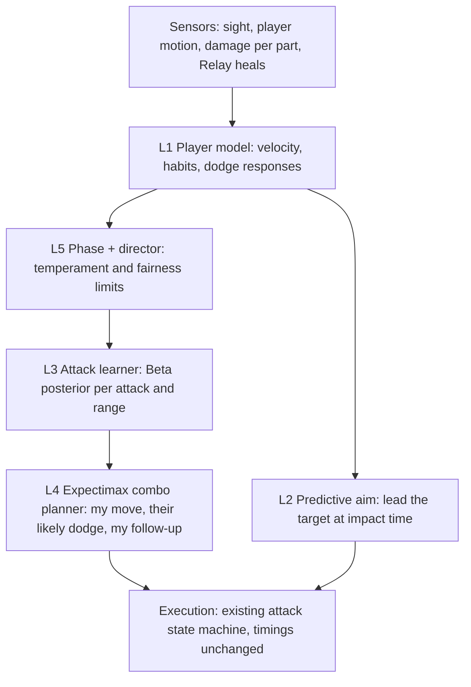

# Rift Warden: Adaptive Boss AI Design

**Agent owner:** Student 1 (additional agent; the graded IS agent is Relay).
**Status:** design baseline (step 1 of the build plan, section 9). The attacks, animations, timings, telegraphs, effects and audio stay exactly as they are; this upgrade changes **how the boss reads the fight and chooses**.

The Rift Warden is the final boss: a 3.4 m crystal machine with a cannon arm (left), a blade arm (right) and a shielded core that opens once both arms are destroyed.

---

## 1. Why upgrade

*Current* (`RiftWardenBrain.cs` before this work): every 0.2 s the boss checks three things (distance to the player, which arms are intact, which cooldowns are ready) and picks from a fixed order: blade, then teleport, then cannon.

| Weakness | Effect on the fight |
|---|---|
| Ignores how the player plays | The same situation always gets the same attack; the boss never notices that you always strafe left or jump the slam |
| Aims at where the player *is* | The cannon locks onto your current position, so constant movement makes you untouchable |
| Fixed priority order | After a minute the whole pattern is readable |
| Ignores Relay | A healer keeps topping the player up and the boss never reacts |
| Same tactics whatever its damage | Losing an arm removes attacks but doesn't change behaviour |
| Movement is "walk at the player" | No cutting off, no positioning |

The goal is a boss that **feels like it is reading you**: it learns your habits during this fight, predicts where you will be, plans two-move combos around your likely dodge, changes temperament as it breaks, and stays fair.

---

## 2. Task environment (PEAS)

| | Rift Warden |
|---|---|
| **Performance** | Damage dealt to the player; attacks that connect; staying unpredictable (attack-choice entropy); protecting its damaged parts. **Constrained by fairness:** every attack keeps its telegraph, and a mercy window applies when the player is nearly dead. |
| **Environment** | Circular arena (radius 12 m) at the end of the dungeon; the player Arc; Relay (healer); open floor with almost no cover. |
| **Actuators** | Movement (`NavMeshMotor`), cannon burst, blade slash, double rear teleport, core teleport and slam, facing. |
| **Sensors** | Line of sight to the player; player position and velocity; damage taken per part (which arm the player is shooting); Relay's position and heals; its own part health. |

**Environment dimensions:** partially observable (the player can break sight), multi-agent and *competitive* (unlike Relay, which is cooperative), stochastic (the player's dodges), sequential, dynamic, continuous, known rules. The opponent's *behaviour* is unknown, and learning it during the fight is the core of this design.

---

## 3. Architecture

Same layered idea as Relay, but adversarial and adaptive.



| Layer | Question | Technique | Lecture / beyond |
|---|---|---|---|
| 1 Player model | How does this player move and dodge? | Smoothed state estimates, per-attack response counts (Dirichlet) | L03 model-based; L09 probability |
| 2 Predictive aim | Where will they be when the hit lands? | Constant-velocity intercept with a fairness cap | Beyond the lectures (target leading) |
| 3 Attack learner | Which attacks actually work on this player? | Bayesian Beta–Bernoulli posteriors with forgetting, Thompson sampling | L09 Bayes, L03 learning agents (exploration vs exploitation), beyond: multi-armed bandits |
| 4 Combo planner | If I do this, how will they react, and what punishes that? | Depth-2 expectimax over the player model | L10 adversarial search, expectimax |
| 5 Phases, tactics, director | How should I behave given my damage and the fight so far? | Hierarchical state machine, utility tactics, dynamic difficulty | L03; beyond: game-AI difficulty adjustment |

---

## 4. Layers in detail

### 4.1 Layer 1: player model (`RiftPlayerModel`)

Sampled every perception tick (0.1 s) while the player is visible.

| Estimate | Update | Used by |
|---|---|---|
| Velocity `v̂` | `v̂ ← v̂ + 0.35·(Δp/Δt − v̂)` (exponential smoothing) | Predictive aim, combo planner |
| Preferred range | EMA of distance to the boss, α = 0.05 | Planner (where they will drift back to) |
| Strafe bias | EMA of the sign of lateral velocity relative to the boss (−1 = left … +1 = right) | Planner, positioning |
| Dodge response per attack | After each attack, classify what the player did between telegraph and impact: **Stay**, **Strafe left**, **Strafe right**, **Back off**, **Close in**, **Jump**. Counts with a Dirichlet(1,…,1) prior, so `P(r | attack) = (n_r + 1) / (N + 6)`. | Combo planner (chance nodes) |
| Target preference | Damage received per part over the last 10 s | Shielding tactic |
| Relay heals | Heal count and position | Healer-punish tactic |

### 4.2 Layer 2: predictive aim (`RiftAim`)

The cannon and slam aim where the player *will be* at impact:

```
aim = p + v̂ · t_lead · κ,     |v̂ · t_lead · κ| ≤ 2.5 m
```

- `t_lead` is the time from aim lock to impact: cannon shots at 0.17 / 0.47 / 0.77 s after the lock; slam 0.23 s after the lock.
- κ (lead factor, 0–0.85) is set by the director. κ < 1 and the 2.5 m cap keep every attack dodgeable by changing direction. A player who keeps running the same way gets punished; a player who reads the telegraph still escapes.
- The cannon's three shots now *walk* along the predicted path instead of hitting one fixed point.

### 4.3 Layer 3: attack learner (`RiftAttackLearner` + `Algorithms/Bandit`)

Each (attack, range band) pair keeps a Beta(α, β) belief about its hit chance against **this** player. Range bands: close < 4 m, mid 4–10 m, far > 10 m.

- **Update (Bayes):** a hit gives α ← α + 1, a miss gives β ← β + 1. The posterior mean is `α / (α + β)`. Each cannon shot is one trial; melee and slam attacks are one trial each.
- **Forgetting:** before each update, α and β are multiplied by γ = 0.97 (floor 1). Old evidence fades, so the boss tracks a player who changes tactics. This makes it a non-stationary bandit.
- **Thompson sampling:** to choose, the boss draws θ ~ Beta(α, β) for each available attack and uses the drawn value. Uncertain attacks sometimes draw high and get tried (exploration); proven attacks usually win (exploitation). This is the exploration/exploitation balance from Lecture 03's learning agents.
- **Priors:** α = β = 2 (a weak "50/50" belief), so early decisions are not swung by one lucky hit.

### 4.4 Layer 4: expectimax combo planner (`RiftComboPlanner` + `Algorithms/Adversarial`)

Depth-2 expectimax (Lecture 10) over an abstract fight state:

```
state  = (range band, attacks ready, phase, my weakest-part health)
MAX    : boss chooses an action (each available attack, Approach, Hold)
CHANCE : player response r ~ P(r | action)                 (layer 1)
         hit ~ θ(action, band) from the learner             (layer 3)
         next state: range band after r, cooldowns advanced by the action's duration
MAX    : boss's best follow-up in that state
value  = expected damage dealt − w_risk · expected damage taken during the action's recovery
```

The planner returns the first action of the best line. Examples of lines it can find:
- "Cannon → they usually strafe left → they end up close → slash."
- "They always back off from the slash → teleport behind instead."

**Why expectimax, not minimax:** the player is not a perfect adversary. Minimax assumes the worst-case reply and makes the boss timid. Expectimax uses the *observed* reply probabilities, so the boss exploits habits. Lecture 10 calls this realism against pessimism.

The tree is small (up to 6 × 6 × 6 × 6 leaves), so it runs every decision tick in well under a millisecond.

### 4.5 Layer 5: phases, tactics, director

**Phases** (hierarchical state machine; the existing action states sit inside each phase):

| Phase | When | Temperament |
|---|---|---|
| Measured | Both arms intact | Normal cooldowns; risk weight 1.0 (cautious) |
| Enraged | One arm lost | Cooldowns × 0.8, recovery 1.15 s → 0.85 s; risk weight 0.6; prefers combos |
| Desperate | Core exposed | Slam cooldown 7 s → 5.5 s; risk weight 0.3; presses the player |

**Tactics** (utility checks inside Pursue):
- **Shield the weak arm:** when an arm is below 50% and the player has been shooting it, the boss turns up to 25° so that arm faces away.
- **Punish the healer:** if Relay has healed in the last 6 s, is visible and is in cannon range, a cannon burst may target Relay. Its utility is scaled by the heal rate, and it fires at most once per 12 s.
- **Cut off:** while approaching, the boss aims for a point that closes the player's preferred escape direction (the strafe bias) instead of walking straight at them.

**Director (fairness / dynamic difficulty):**

| Condition | Response |
|---|---|
| Player health < 25% | **Mercy** for 6 s: lead κ = 0.4, no chained combos, +0.5 s recovery |
| Player > 80% health and the boss lost > 30% of a part in the last 20 s | **Pressure:** κ up to 0.85, cooldowns × 0.9 |
| Otherwise | κ = 0.65, normal |

Hard limits never change: telegraph times, damage values and the jump rule for low attacks.

---

## 5. Constraints

- **Fixed:** the attack timings, damage values, telegraphs, animations and the `RiftAction` enum. Presentation scripts (`RiftAttackFx`, `RiftBossAudio`, `RiftArenaMood`, `RiftCombatImpact`, `RiftBossIntro`) read `Action` and keep working.
- **API:** `RiftWardenBrain`'s public API is unchanged (`Activate`, `ResetEncounter`, `DamagePart`, health properties, counters, `Decision`).
- **Pure C#:** the algorithms (Beta sampling, expectimax) live in `Skybreak.AI.Algorithms` with EditMode tests.
- **Budget:** a decision tick (every 0.2 s) stays under 1 ms.

## 6. Code structure (planned)

| File | Contents |
|---|---|
| `RiftWardenBrain.cs` | Orchestration and the existing attack state machine (execution) |
| `RiftPerception.cs` | Sight and memory (step 1), then the player model (step 2) |
| `RiftUtility.cs` | Step 1: the original attack scores, unchanged |
| `RiftAim.cs` | Predictive aim |
| `RiftAttackLearner.cs` | Beta posteriors per attack and range band |
| `RiftComboPlanner.cs` | The expectimax state model |
| `RiftDirector.cs` | Phases, tactics, fairness |
| `RiftDebugOverlay.cs` | F10 live view |
| `Algorithms/Bandit/*.cs`, `Algorithms/Adversarial/*.cs` | Beta distribution and Thompson sampling, expectimax |

## 7. Verification

- **EditMode tests:**
  - Beta posterior mean and sampling moments.
  - Thompson sampling converges to the best arm in a simulated bandit.
  - Expectimax against hand-solved trees, including the case where expectimax and minimax disagree.
  - Intercept prediction.
- **Regression snapshots:** fixed lab scenarios. Step 1 must reproduce the old behaviour exactly.
- **Evaluation (step 6):** scripted player archetypes (strafer, jumper, kiter, camper) fight the old boss and the new one. Measures: hit rate in the first and last 30 s (does it learn?), damage to the player, attack-choice entropy (predictability), time the player is below 30%, mercy activations, and the minimum reaction time per attack (fairness).

## 8. AI assistance

This design and its implementation are developed with AI assistance (Claude). Record each step in `Docs/CONTRIBUTION_LOG.md`.

## 9. Build plan

| Step | Work |
|---|---|
| 1 | This document, and splitting perception and attack scoring out of the brain with **no behaviour change** |
| 2 | Player model and predictive aim |
| 3 | Attack learner (Bayesian bandit) |
| 4 | Expectimax combo planner |
| 5 | Phases, tactics, director |
| 6 | F10 overlay and archetype evaluation, old boss against new boss |
| 7 | Study-guide section |
